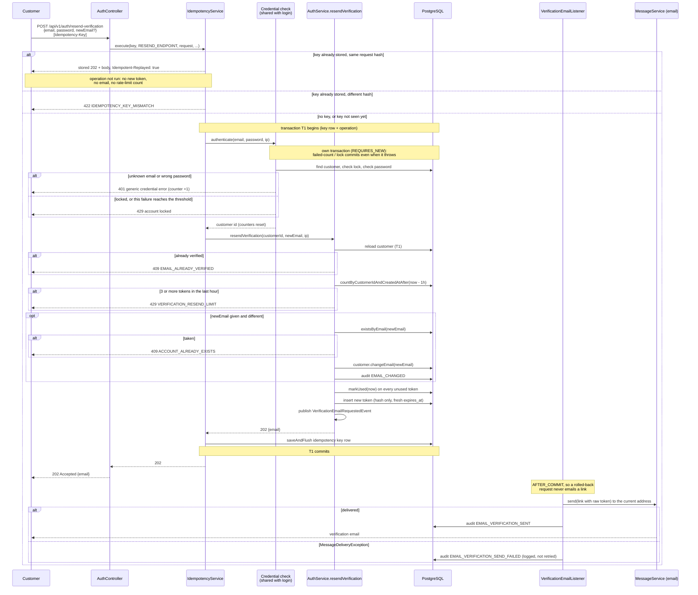
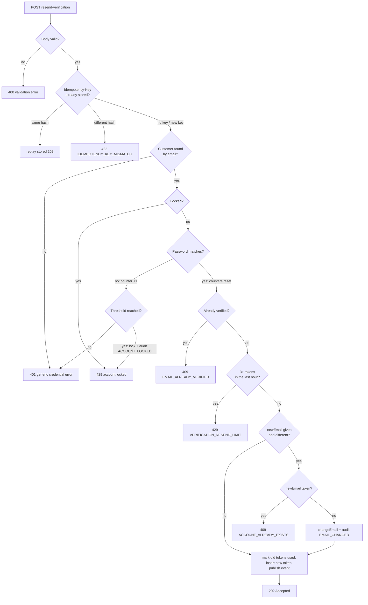

# Resend verification email sequence (`FR-40`)

Captures the design for `FR-40`, settled on 2026-11-02 (see `subscribe_master_requirements.md` for the formal requirement and `IMPLEMENTATION_BACKLOG.md` for wave placement). Two diagrams, because they answer different questions:

- **Sequence diagram:** who calls whom, and where the transactions start and end. The email goes out only after commit, which is why the endpoint answers 202 rather than 200.
- **Flowchart:** the order of the checks, and the status code each one returns. Each check sits where it does for a reason (see "Key decisions").

## Sequence: a request that sends a new link

Any rejection inside T1 (409 or 429 from `AuthService`) rolls T1 back, so nothing is stored under the key and a retry runs again. The credential check's counter update isn't part of T1, so it survives.

## Order of checks and their responses

## Key decisions this diagram encodes

- **202, not 200.** At response time the server has committed a new token and published the event, nothing more. The send happens after commit and can fail (recorded by `NFR-34`'s `EMAIL_VERIFICATION_SEND_FAILED`), so "accepted for sending" is the honest answer.
- **The password is checked the way login checks it, with the same lockout.** A wrong password counts toward `failedLoginCount`/`lockedUntil` and gets the same 401/429. Otherwise this endpoint would be an unthrottled password-guessing oracle beside login.
- **The credential check runs in its own transaction (`REQUIRES_NEW`).** `IdempotencyService` runs the operation inside a `TransactionTemplate`, which rolls back on any `RuntimeException`, so `login`'s `noRollbackFor` would not save the counter here. Without a separate transaction, a caller sending a fresh `Idempotency-Key` with every guess would never be locked out. Because it's a separate transaction, it has to be a separate bean (self-invocation skips the proxy), like `SubscriptionStatusUpdater`.
- **The credential check runs inside the operation, not before `execute()`.** A retry of a request that changed the address still sends the *old* email. Checking first would then answer 401 instead of replaying the original 202.
- **Verified before rate limit before address change.** A verified account gets 409 without touching the rate limit. The limit is checked before `newEmail`'s clash check, so a request that would only probe whether an address is registered is still capped once the account is over its limit. A clash probe below the limit leaks nothing registration doesn't already leak.
- **Old tokens are marked used, never deleted.** The rate limit counts token rows by `created_at`, so deleting them would reset it. `verify()` already rejects a used token on an unverified account (400), so a link sent to the old address can't verify the account under the new one.
- **A replay runs nothing.** No new token, no email, no rate-limit count. Its stored body holds only the address, never the raw token.
- **A new event, not `CustomerRegisteredEvent`.** `VerificationEmailRequestedEvent` keeps "new customer" consumers (`NFR-28`) from firing on a resend. The listener gets a second method sharing a private send helper with `onCustomerRegistered`.

## Not covered

- Notifying the old address when the email changes.
- Retrying a failed send (tabled under `NFR-34`).
- `FR-32`'s cleanup must use the customer's **latest** token's `expires_at` once resends exist. That change belongs to `FR-32`.
